# jev-demofast

[](https://onecentdemo.com)

**One sentence in, a narrated product demo out.** Tell it what to show and to whom. It explores your site, writes the
voice-over a founder would give, drives a real browser through it, and hands you an MP4.


That GIF is the unedited output, about 20 seconds from sentence to video. Here is the run behind it: an LLM plans the
route once, then Jev, a small decision model, picks each element in about a quarter of a second.



**Two ways to try it:**
- **In your browser, nothing to install:** [app.onecentdemo.com](https://app.onecentdemo.com). Sign in and get $3 of
  free credit, twelve demos.
- **On your own machine:** this repository. It's free and MIT-licensed; you bring your own keys and a demo costs cents.

## Built on NVIDIA Nemotron and Nebius Token Factory

The script, the plans and the page reading run on **NVIDIA Nemotron 3 Ultra** through
[Nebius Token Factory](https://tokenfactory.nebius.com): on the hosted app always, and on your machine with
`JDF_LLM_PROVIDER=nebius`. Nemotron does the thinking a founder would. Jev (on Cloudflare Workers AI) makes the
quarter-second click decisions, a vision model checks the result, and ElevenLabs speaks the voice-over.

| Step | What Nemotron does | Thinking |
|---|---|---|
| **The founder's script** | Reads the brief and the site's map, writes the voice-over and picks the pages to show | on |
| **Fitting the narration** | Fits the script over what was actually recorded, correcting only what differs | on |
| **Planning a route** | Turns a goal into the steps to get there (Open Source → Trending → This week) | off |
| **Reading pages** | Picks filter values, form values and the items worth pointing out | off |

Why the split: with thinking off, the script came out as captions of the screen ("Select $126 to $150 range"); on, it
keeps a founder's voice and sticks to the facts on the page, and it runs only twice per video. Plans run on every
step, so speed wins there: of the four Nemotron models on Token Factory, Ultra with thinking off planned the GitHub
route best, in about 1 s; with thinking on, every model took 4–15 s. Measured with Nemotron doing this work, a
sentence becomes a narrated video in about 16 s. The models and their settings are in
[`src/jev_demofast/config.py`](src/jev_demofast/config.py).

## Quickstart

You need Python 3.12+, [uv](https://docs.astral.sh/uv/), ffmpeg, Google Chrome, a
[Nebius Token Factory](https://tokenfactory.nebius.com) API key for Nemotron, and a Cloudflare account with Workers AI.
Jev, the model that makes each click decision, is paid from AI Gateway credits: add a few dollars under AI → AI
Gateway → Credits.

```bash
git clone https://github.com/q3learners/jev-demofast && cd jev-demofast
uv sync
export CLOUDFLARE_ACCOUNT_ID=...  CLOUDFLARE_API_TOKEN=...    # a token with Workers AI access
export JDF_LLM_PROVIDER=nebius  NEBIUS_API_KEY=...             # Nemotron on Token Factory (else Workers AI's GLM)

uv run jev-demofast chrome      # starts its own Chrome; your browser and logins are untouched
uv run jev-demofast demo "Show how to find hot trending projects on GitHub this week" \
    --url https://github.com/ --out github.mp4
```

The video, the founder's script (`story.txt`) and a log of every decision land next to `github.mp4`.

## More to try

**Add a voice.** Set `ELEVENLABS_API_KEY` and add `--voice chris` (or `eric`, `will`, `sarah`, `jessica`). The
voice-over is spoken in one take and the video follows it.

```bash
uv run jev-demofast demo "Show my investors how easy it is to find men's running shoes under \$150 on our site" \
    --url https://www.allbirds.com/ --voice chris --out allbirds.mp4
```

**Use your product's own words.** `--repo` reads your public README so the script says what the product is, in your
words. Nothing is cloned or run.

```bash
uv run jev-demofast demo "Show founders how this turns one sentence into a narrated demo" \
    --url https://onecentdemo.com/ --repo https://github.com/q3learners/jev-demofast --voice eric --out ours.mp4
```

**Demo your own app.** For a Next.js app, build a map from the source first; Jev then drives without an LLM plan. Log
in once with `jev-demofast chrome --open <your login page>` and later demos start logged in.

```bash
uv run jev-demofast index ../my-nextjs-app --out app-index.json
uv run jev-demofast demo "Invite a teammate as a member" --url https://staging.example.com --index app-index.json
```

## What you get

- **A founder's script, written first.** Who the demo is for and why, then a page-by-page tour of your site, then the
  payoff.
- **A real browser on camera.** Pages scroll smoothly, menus open, filters get ticked, and each element used is
  outlined.
- **Honest results.** If a step fails, the video ends on the error and the narration says so. It never fakes a success.
- **Safe by default.** It stays on your site, never signs up or deletes anything, and blurs what it types. Use
  `--dry-run` to stop before anything that changes data, and point it at staging.
- **Every decision on record.** `replay.json` shows each choice Jev made, with its options and timing.

## Learn more

- [The guide](docs/guide.md): every option, logins, voices, models, configuration, measurements and limits.
- [How it works](docs/how-it-works.md): each stage and the experiments behind it.
- [The story](https://www.linkedin.com/pulse/jev-couldnt-find-password-reset-form-we-gave-map-venkat-podugu-p23fe/):
  Jev couldn't find the password reset form. Then we gave it a map.

## Contributing

Contributions are welcome, especially map readers for more frameworks (React Router, Remix, Rails, Django). Start with
the [good first issues](https://github.com/q3learners/jev-demofast/labels/good%20first%20issue) and
[CONTRIBUTING.md](CONTRIBUTING.md); the tests run offline.

## Credits

Built on [browser-use/jev-ultrafast](https://github.com/browser-use/jev-ultrafast) and
[laya-ultrafast](https://github.com/ipenywis/laya-ultrafast) (MIT, Browser Use; see `NOTICE`),
[browser-harness](https://pypi.org/project/browser-harness/) (MIT), and Jev by [TypeSafe](https://typesafe.ai),
used through Cloudflare Workers AI. Not affiliated with TypeSafe or Browser Use. MIT License.
